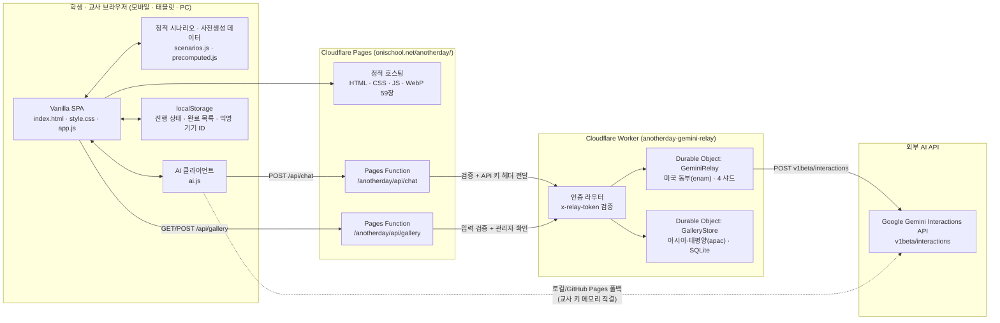
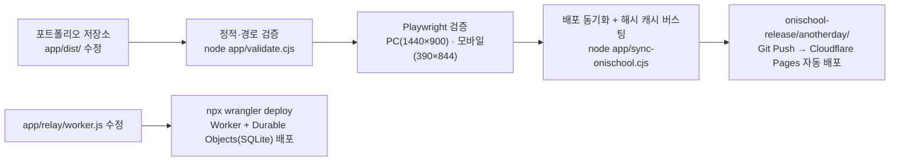

# 아키텍처 소개 · 다른 곳의 하루

**「다른 곳의 하루」**([https://onischool.net/anotherday/](https://onischool.net/anotherday/))는 중학교 도덕 「지구촌 문제」 수업에서 학생이 휴대폰·태블릿·PC로 접속해 지구촌 또래 12명 중 한 명의 하루를 체험하고, 조사·글쓰기·AI 피드백·학급 갤러리 공유까지 이어 가는 대화형 시뮬레이션 웹앱입니다.

이 문서는 현재 배포·운영 중인 웹앱의 **프론트엔드, 백엔드, AI 연동, 데이터베이스, 검증 및 배포 구조**를 정리한 기술 소개서입니다.

---

## 1. 한눈에 보는 전체 아키텍처

별도의 상시 서버(VM·컨테이너) 없이 **정적 프론트엔드 + Cloudflare 서버리스 엣지(Pages Functions · Workers) + Durable Objects(SQLite) + Google Gemini API** 조합으로 구성했습니다.

### 기술 스택 요약

| 계층 | 사용 기술 | 역할 |
|---|---|---|
| **프론트엔드** | Vanilla HTML5 · CSS3 · ES6+ JavaScript (빌드 도구 없음) | SPA 화면 전환, 12명 분기 시나리오, 룰렛·장면 전환 연출, 3종 결과물 서식, 갤러리 UI |
| **클라이언트 저장** | Browser `localStorage` | 진행 중인 체험·대화·작성 글 자동 저장(`global-life-lab-v1`), 기기별 하트 식별(`anotherday-voter`) |
| **정적 호스팅 · API 게이트웨이** | Cloudflare Pages & Pages Functions | 정적 에셋 배포, API 키 은닉, 출처·프롬프트·모델·속도 제한 검증 |
| **백엔드 중계 · 컴퓨팅** | Cloudflare Workers + Durable Objects | 한국 학교망의 홍콩(`HKG`) 경유 Gemini 지역 차단 우회(미국 동부 `enam` 고정 중계) |
| **데이터베이스** | Durable Object 내장 SQLite (`GalleryStore`) | 학급 갤러리 결과물(`subs`) 및 기기별 공감 하트(`hearts`) 영구 저장 |
| **생성형 AI** | Google Gemini Interactions API (`gemini-3.8-flash`, `gemini-3.5-flash-lite`) | 장면 자유 대화, 상황 브리핑·첫머리, 조사 도우미, 당사자·교사 피드백 대화 |
| **테스트 · 자동화** | Node.js(`validate.cjs`, `sync-onischool.cjs`), Playwright, Python | 시나리오·경로 정합성 검증, PC/모바일 E2E 및 화면 캡처, 캐시 버스팅 배포 동기화 |

---

## 2. 프론트엔드 아키텍처 (`app/dist/`)

프레임워크(React/Vue 등)나 번들러(Webpack/Vite)를 두지 않는 **Zero-build Vanilla SPA** 구조입니다. `app/dist/` 폴더 전체가 그대로 배포 산출물이며, 학교 현장 환경에서 빠른 초기 로딩과 단순한 유지보수를 목표로 설계했습니다.

### 2.1 핵심 파일 구성

| 파일 | 크기(약) | 담당 역할 |
|---|---:|---|
| [index.html](app/dist/index.html) | 2.4 KB | 앱 셸(상단 내비게이션, `<main id="app">`, 모달, 토스트), 웹폰트(Pretendard Variable · Gowun Batang), 반응형 히어로 이미지 `<link rel="preload" fetchpriority="high">` |
| [style.css](app/dist/style.css) | 66.8 KB | 모바일 우선 반응형(`≤900px`, `dvh`, 44px 터치 영역, iOS 확대 방지 16px 입력), 캐릭터별 포인트 컬러(`TONE`), 하늘 그라데이션 장면 전환(`.daypass`), 신문 기사·정책 제안서·편지 3종 문서 레이아웃 |
| [app.js](app/dist/app.js) | 106.4 KB | 상태 관리(`state`), 뷰 라우터(`FREE_VIEWS` 5종 · `RUN_VIEWS` 6종), 룰렛 뽑기, 장면 분기 해석(`resolveCase`), 상황별 이미지 매핑(`SCENE_ART`) 및 순차 큐 프리로더, 글자 수·성격 체크, 갤러리 CRUD·하트 UI |
| [scenarios.js](app/dist/scenarios.js) | 67.6 KB | 12명 캐릭터, **47개 장면, 94개 선택지, 96개 전체 경로**(8명 분기 트리 포함), 확인된 사실 및 공신력 출처(UNDP·UNICEF·WFP·ILO·UNHCR·NRC·국제앰네스티) |
| [precomputed.js](app/dist/precomputed.js) | 180.6 KB | 모든 선택 경로별 사전 생성 브리핑·일과·장면 첫머리 데이터. AI 호출 지연·비용을 줄이고 AI 미연결 환경에서도 체험이 끊기지 않게 지원 |
| [ai.js](app/dist/ai.js) | 34.5 KB | Gemini Interactions API 클라이언트, 5종 JSON Schema 강제 출력, 안전 규칙·필터 설정, 서버 자동 감지(`GET api/chat`) 및 직결 폴백 |

### 2.2 화면 흐름과 상태 관리

- **자유 탐색 뷰 (`FREE_VIEWS`)**: `home`(히어로 앨범 홈) · `atlas`(12명 캐릭터 목록) · `gallery`(학급 결과물 보드) · `guide`(3차시 수업 안내 및 기록 초기화) · `select`(캐릭터 룰렛 뽑기)
- **체험·탐구 뷰 (`RUN_VIEWS`)**: `intro`(인물 소개) → `chat`(아침·낮·저녁 대화 및 선택) → `reflect`(돌아보기) → `lab`(글 종류 선택 + 질문·AI 조사) → `plan`(종류별 글쓰기 + 성격 체크 + AI 피드백 대화) → `report`(완성 서식 보기 및 갤러리 제출)
- **분기 해석**: `scenarios.js`의 낮·저녁 슬롯이 배열이면 `branchIndex`와 `resolveCase`가 이전 선택(`[0|1, 0|1, 0|1]`)에 맞는 장면 객체를 동적으로 선택합니다.
- **로컬 영속성 (`localStorage`)**:
  - `global-life-lab-v1`: 현재 진행 중인 캐릭터·단계·선택·대화 로그·작성 칸(`state.run`)과 완료한 캐릭터 목록(`state.completed`)을 자동 저장해 새로고침 후에도 이어하기가 가능합니다.
  - `anotherday-voter`: 기기별 무작위 식별자를 저장해 갤러리 하트를 **1기기 1표**로 유지합니다.

### 2.3 미디어 및 로딩 성능 최적화

학교 와이파이와 모바일 접속 환경을 고려해 이미지 전달 파이프라인을 세밀하게 최적화했습니다.

- **경량 WebP 59장(총 약 2.65 MB)**: 인물 대표 전신 12장(660×884) + 원형 얼굴 썸네일 12장(200×200) + 상황별 낮·저녁 장면 35장(660×880)을 2x 레티나 표시 크기에 맞춰 압축했습니다.
- **단계별 프리로드 큐**:
  1. `index.html`에서 첫 화면 히어로 상위 이미지(모바일 2장, 데스크톱 4장)를 `<link rel="preload" fetchpriority="high">`로 우선 수신합니다.
  2. 히어로 앨범은 첫 화면에 보이는 4장 디코딩 완료 즉시 자동 재생을 시작하고, 나머지 에셋은 동시 2장 순차 큐(`enqueuePreload`)로 배경 로드해 대역폭 경합을 막습니다.
  3. 캐릭터 진입(`intro`) 및 선택 확정 시점에 다음 도달 가능한 분기 장면만 우선 프리로드(`preloadCaseScenes`)하며, 장면 전환(`dayPass`) 애니메이션 동안 다음 장면 이미지 디코딩을 대기해 깜빡임 없이 전환합니다.

---

## 3. 백엔드 아키텍처 (Cloudflare Serverless + Durable Objects)

수업용 배포 환경(`https://onischool.net/anotherday/`)의 백엔드는 **2계층 서버리스 엣지 구조**로 동작합니다.

### 3.1 1계층: Cloudflare Pages Functions (보안 게이트웨이 · 검증)

`onischool` 사이트 저장소의 `functions/anotherday/api/`에 배치되어 프론트엔드와 같은 도메인(`/anotherday/api/*`)에서 요청을 받습니다.

1. **`/anotherday/api/chat` (`chat.js`)**
   - **API 키 은닉**: `GEMINI_API_KEY`를 Cloudflare Pages Production Secret으로만 보관하며 브라우저로 절대 내려보내지 않습니다. (`GET /api/chat`으로 설정 여부 `{"ok":true,"configured":true,"relay":true}`만 반환)
   - **보안·남용 방지**:
     - 허용 출처(`onischool.net`, `*.pages.dev`, `localhost`) 검사
     - 시스템 지시문 머리말(`PROMPT_PREFIX`) 일치 검증으로 임의의 범용 챗봇 오용 차단
     - 허용 모델 화이트리스트(`gemini-3.8-flash`, `gemini-3.5-flash-lite`) 제한
     - 서버 측에서 `store: false`, 안전 필터 4종, `max_output_tokens: 2048` 강제 주입
     - 요청 본문 120 KB, 대화 스텝 80개, IP당 분당 240회(학교 공용 NAT IP 고려) 상한 적용
   - 검증을 통과한 요청에 `RELAY_TOKEN`과 `x-goog-api-key` 헤더를 붙여 중계 Worker로 전달합니다.

2. **`/anotherday/api/gallery` (`gallery.js`)**
   - 출처·크기·입력값(학년 1~6, 반 1~30, 번호 1~60, 이름 10자 이내, 결과물 형식)을 검증합니다.
   - 교사 **관리 모드** 요청은 Pages Secret `GALLERY_ADMIN` 비밀번호와 일치할 때만 허용하며, 검증된 요청만 `RELAY_TOKEN`을 붙여 Worker의 `/gallery/*` 경로로 전달합니다.

### 3.2 2계층: Cloudflare Worker & Durable Objects ([app/relay/worker.js](app/relay/worker.js))

단일 Worker(`anotherday-gemini-relay`, [wrangler.toml](app/relay/wrangler.toml)) 안에서 두 개의 Durable Object를 역할별로 분리 운영합니다. 모든 요청은 `x-relay-token` 헤더가 일치해야만 처리됩니다.

#### ① `GeminiRelay` Durable Object (AI 지역 차단 우회 중계)
- **해결한 문제**: 한국 학교 공공망에서 Cloudflare Pages에 접속하면 지리적 라우팅에 따라 홍콩(`HKG`) 데이터센터로 연결되는 경우가 많습니다. Google Gemini API는 홍콩에서 발신된 요청을 `User location is not supported for the API use.` 오류로 차단합니다.
- **구조**: `locationHint: 'enam'`(미국 동부)으로 고정된 `GeminiRelay` Durable Object 4개 샤드(`relay-enam-0`~`3`)로 요청을 분산해 Gemini API를 호출합니다. API 키는 Worker에 저장하지 않고 Pages Function이 요청마다 헤더로 전달합니다.

#### ② `GalleryStore` Durable Object (SQLite 기반 학급 갤러리 DB)
- **위치**: 한국 학생 접속 지연을 최소화하기 위해 `locationHint: 'apac'`(아시아·태평양) 단일 인스턴스(`anotherday-gallery`)로 배치했습니다.
- **데이터베이스 스키마 (Durable Object 내장 SQLite)**:

| 테이블 | 기본 키(PK) | 주요 컬럼 | 동작 규칙 |
|---|---|---|---|
| `subs` | `key` (`학년-반-번호`) | `grade`, `cls`, `num`, `name`, `cid`, `format`, `data`(JSON), `created`, `updated` | 학생 1인당 1작품(`INSERT OR REPLACE`로 재제출 시 덮어쓰기). 일반 조회 시 이름 가운데 마스킹(`홍*동`), 교사 관리 모드 시 실명 조회 및 삭제 가능 |
| `hearts` | `(key, voter)` | `key`, `voter`, `created` | 한 기기(`voter`)당 결과물 1개에 1표(`INSERT OR IGNORE` / `DELETE`). 결과물 삭제 시 해당 하트도 함께 삭제 |

- **지원 엔드포인트 (내부 Worker 라우트)**: `/gallery/list`(목록·하트 수·내 하트 여부 조회), `/gallery/submit`(제출·덮어쓰기), `/gallery/heart`(하트 토글), `/gallery/delete`(교사 삭제)

---

## 4. 생성형 AI 연동 설계 ([app/dist/ai.js](app/dist/ai.js))

Google Gemini **Interactions API**(`https://generativelanguage.googleapis.com/v1beta/interactions`)를 사용합니다.

- **비저장(Stateless) 대화**: 모든 요청에 `store: false`를 지정해 학생 대화가 Google 서버에 저장되지 않게 하며, 현재 장면의 대화 스텝 배열을 클라이언트가 함께 전송합니다.
- **JSON Schema 구조화 출력**: `response_format`에 엄격한 JSON Schema를 지정해 UI가 안정적으로 파싱할 수 있는 필드만 받습니다.
- **4가지 AI 역할 분리**:
  1. **장면 자유 대화 (`turn`)**: 서술자·주변 인물 역할 수행. `narration`, `speaker`, `dialogue`, `decision`, `chips` 반환. 최소 3턴(`MIN_TALK = 3`) 대화 전에는 결정을 막아 충분한 탐색을 유도합니다.
  2. **장면 첫머리·브리핑 (`opening`, `brief`)**: 앞 장면의 선택과 대화를 이어받아 다음 장면 첫머리와 결과 브리핑(내가 간 길 vs 다른 길 + 시간대별 일과)을 생성합니다. 첫 장면 칩만 받을 때는 경량 모델(`gemini-3.5-flash-lite`)로 응답 속도를 높입니다.
  3. **조사 도우미 (`research`)**: 학생 질문에 중학생 눈높이로 답하되, 화면에 제공된 출처 목록(`refs`) 외의 링크·통계·숫자 창작을 금지하고 근거 자료 제목을 연결합니다.
  4. **결과물 피드백 대화 (`review`)**: 이야기 속 **당사자 인물**(현실적 고민·조건 피드백)과 **선생님**(글의 종류별 6개 성격 기준·근거·실행 가능성 피드백)이 번갈아 답하며, 글을 대신 써 주거나 점수를 매기지 않습니다.
- **안전장치 및 복원력**:
  - 4종 안전 필터(`hate_speech`, `sexually_explicit` 중간 이상 차단 / 아동노동·전쟁·가뭄 등 수업 주제를 고려해 `harassment`, `dangerous_content`는 심각 수준만 차단) + 프롬프트 레벨 `SAFETY_RULES`(죽음·폭력·연애 금지, 개인정보 입력 주의, 실제 위기 호소 시 어른 상담 안내).
  - 안전 필터 오탐 시 1회 자동 재시도하며, 서버가 없는 로컬·GitHub Pages 환경에서는 교사가 입력한 키로 브라우저 직결 모드(메모리 보관) 또는 대본 기반 오프라인 모드로 폴백합니다.

---

## 5. 검증 및 배포 파이프라인

- **데이터·문법 검증 (`app/validate.cjs`)**: 12개 시나리오, 47개 장면, 94개 선택지, 96개 전체 경로의 `precomputed.js` 일치 여부, `SCENE_ART`에 등록된 35장 장면 WebP 파일 존재 여부, `ai.js`·`app.js` 문법을 일괄 검사합니다.
- **화면·기능 자동 검증 (`app/tools/*.mjs`)**: Playwright Chromium으로 분기 흐름(`branch-flow.mjs`), 갤러리 하트(`check-gallery-hearts.mjs`), 글자 수·장르 글쓰기(`check-genre-writing.mjs`, `check-min-length.mjs`), 피드백 수정(`check-feedback-edit.mjs`), 초기화(`check-reset.mjs`) 등을 PC·모바일 해상도로 검증합니다.
- **캐시 버스팅 배포 (`app/sync-onischool.cjs`)**: `app/dist/`를 배포 사이트 저장소(`onischool-release/anotherday/`)로 복사할 때 CSS/JS 파일 내용의 SHA-1 해시 10자리를 `index.html`의 `?v=<hash>` 쿼리에 자동 주입해 Cloudflare 엣지/브라우저 캐시 문제를 방지합니다.

---

## 6. 관련 문서

- [프로젝트 루트 README](README.md) — 포트폴리오 전체 구조, 배포 주소, 제출물 안내
- [앱 실행 및 개발 안내](app/README.md) — 로컬 실행, 검증 명령어, 배포 절차
- [작업 인계 문서](app/HANDOFF.md) — Cloudflare Secret 설정, 중계 Worker 운영 상세
- [개선 체크리스트](CHECKLIST.md) · [프롬프트 및 작업 기록](PROMPTS.md) — 기능·디자인 개선 이력과 전후 검증 근거
