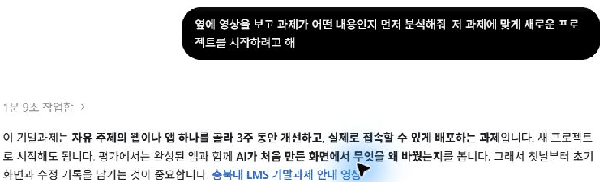
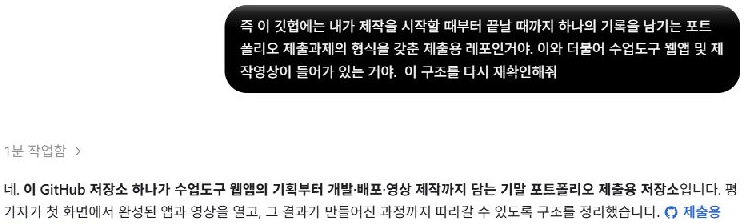
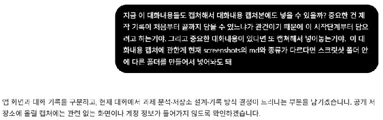

# 제작 결정과 대화

## 2026-11-25 · 기획 시작

1. **과제 분석부터 시작했다.** 첫 요청과 답변에서 초기 화면과 수정 기록을 남겨야 한다는 점을 확인했다.

2. **제출 단위를 정했다.** 수업도구 웹앱, 제작 영상, 작업 이력을 하나의 공개 저장소에 담기로 했다.

3. **기획 대화도 증거로 보존하기로 했다.** 구현 전부터 중요한 요청과 결정이 나온 대화 화면을 남긴다.

세 이미지는 실제 대화 창에서 본문 영역만 잘라 저장한 것이다.
